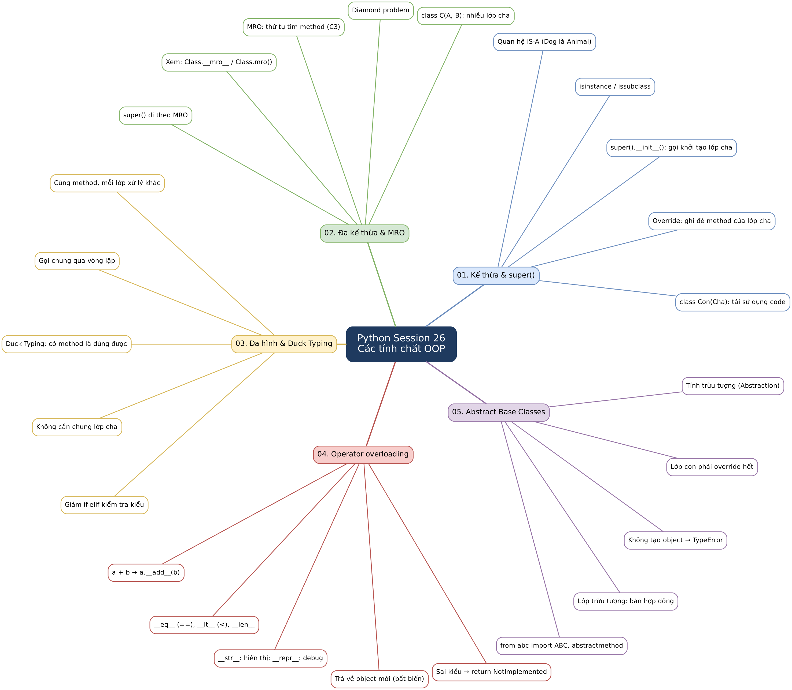

# Mindmap Python Session 26 - Các tính chất của lập trình hướng đối tượng

Sơ đồ tư duy tổng hợp kiến thức Session 26 của khóa Python: **Kế thừa (Inheritance) & `super()`**, **Đa kế thừa & MRO**, **Đa hình (Polymorphism) & Duck Typing**, **Operator overloading** và **Abstract Base Classes**.

🔗 **Link mindmap (draw.io):** [Mở mindmap trên draw.io](https://www.draw.io/#R3Zxbc5s4FMc%2FDTPOQzvowu3R2Gmn0%2B2mu%2BnM7hsjG8Vmw8XFOGn20%2B%2BRuMQYue2skTq4LwVhwJZ%2B%2Bev8zxFYZJF9e0hSbpFbiyzihG1KllnYzlkGbUsL409JHmdsB1v1Z7Jv70u2234qYp7WLWVRVO2xBU9TOD2J65NtcRp%2Bd%2BYokkftHSt5Xv3MCfJO8pwnlh6aL%2Fj5pdoWObTd8%2F0%2BkVvYtbCbwiXDVQlbG7G1sBbEmqM1HK7k5jLfwvZ6a90iK5xbcwcubd%2Fdfa5vsK9eUt7e9ZDHXHwFBNd53iYVv9%2BxtTj6DF0BbdsqS5vD0JnpokiLUp5L0ANhzoNoL%2FLqqP1B%2FoP2fVUWj%2FzcGffJv%2BI20C3NfvOtxJ2ajuBlxb%2Bd7U90PG68yHhVvsBHmhM8hOtTXup912v2n5O42tZtmHh125Ynm21z2fZzbF%2Fvb7pLv44ebDQDqB7M1B4MpY3eQsPHZkTCd2Ks6vEJrXnILIGHy7Kd%2FPX2%2FrDj5exm1PGKGfcf1qpxcdc%2BX52MC3L0jEtA%2BuPiUH8wLsj3h%2BNC3MvHhbcDc9SlPI%2FnZVk8w15e5NAYrg%2FlU9fH5zurPvJX87VJ1z083vDvdw7cvziUa376l1%2BxcsOrY4SG3VjylFXJU%2F8Ol7EaDWldp2y%2Fh6ZFkc8WW3ZjkXknLigRP6BFFz5tx%2B2Ok2%2BE7oB%2BjkrueUVRkkvGIRWRAPUlxCZDCaGuNlQjbbDi%2Fw1r%2BwfURzUyCCsawHoHw1wmwJyEdLMVfFoLasHwCV5BS2y40baIBZstqp6Q3LTZC8KdnC%2FZVWDb4tdgS4kzxNZD%2BrBFk8EWmcMWD7Bt5vi3UZTkSRVFs0ZlNw2U%2FlKA%2FNgGCcG7REpwE9Kh4lr5xTTo8Yt9quBXX4TQDtUE%2BMXm%2BCUDfpN9ku8rlsN3FMGriGiT%2Ff6wamKH6YOIWvAaEJGjCFU9qg9EMhkQiTkQ6QDEPw5MOONWKH0wdfaH%2BzdCS2fLYiN1UgQC8NXteZ5kLL25Bjxt5PTDU8U0jzVO83QydFJTdA5jUxu%2FbaNRW0Scjz%2BZAPj059245t%2FhfkxVg%2BDjFXFdM%2BbfbRW0DU1dNFTUgOhi9vLAtOsszebfWGCKvmf%2BZyChcAk7bCLTHKxVo7Ho8AvDTyWyI8mqf4IoGhIK0quN0BE8%2FxlGL1BVpCLUnOdHCs%2B%2FTFhW5MLR78pilfLsCtDzTiZ0e6iN1NFHHpoMeQbVcWjbxcxcZ0O72TvojHlohahLlC6y48zTbEFurgBSGvT1kSjMOQr0UYonQyk2R%2BnQnP8NiigpXYjJHHJMWVlEUWfU61Zom10Dk4TY%2FTnb9kwm6tEIRt0UlMQclPRcxrNLz8uE5pYXGvzOrwER035xE9JDwznc1Rg90smAaMyTD2dwm%2FQ9%2BbaereWaiWMPvjysH%2BG%2FLy%2B7RNQ1x6UTr5Wl%2BNhduY4hN069fn7TDWxFBsnTRevlM3nXWZrduLGZHCvcuFzcEwayst4Gk8KUZ6359pKBFf92XJ2Xyc9wWdeS2oVCRqRWCfNo6c%2F%2BnE8co3M%2BHsGon8H3AqnFKnjNGXWsMOrve9XM9fYgQf56EML7JMnE%2BaYDGBKj3u4K6HT7JslBqkVOVB%2BcaDJwInNwDiOB%2Fgwv%2FdJaMkmOnftr9Sg%2B0uJ2hYlrhXYrt%2BQalNX%2BcVDg6QsKIjwZdA2GBUOD%2F1HO5SGtV9y1q0K8%2FEhkf1V6Xquwkh6dvrKA5Oijk0yGTmKOzqHTf5%2B0RBKRBE0e3vA0eRAhaFdBkgeqkvUbD9cQmmJ8ko7CWEGprY9SOhlKjaUBhgpqU5EGuIOUFKvgZ2O7gFFPCxaP7vb9NVe7%2FZXvUMc2VHunfekMFDEpJKd0QXm5cHadpdntGxNOonD79ToQkX1aia1bbPmuFchbQRKfxTGsE12Zytkr8RwrVYqCkzq7qxBJV1ugSUYw8GeIvEAkiYpHcwaeKAx8FPGvsnI0E%2FtkeVOnn6IorZrm5nm01wM8F0cmjyix%2BwvpEfYUXog4%2BhBFk0EUmUMUKxCFXwfISQP%2FukaJ5MdVej%2Bss%2FpRVPJd9%2BmYrw6bK2CVkpNlS4QqWKVEH6t4Mqxic6wOo84vZeeMZAa0XU8n4s%2FVP3xdHaf2Q5Ezna16j%2FGukm4JaX4NgYDrnxTvoQSpCEyRPnLJZMg1GJoOPf09SwZevRehlrw6lEJzfy%2BqD9kOFuXBT4ROmz6jvn8SrBJXYZ4cjZEAnQyjxhz9kFDbEY5%2BvoJfyKSQhmzP29VOfNxnkjiCJfWeqqMD1yPMUAk%2FwP1HlH2CTC7Hu5zKrrM0m3pzVCpM%2FUNZiGQnW4k3dCTZrigFnHN4b4d0TKwBti04GZFLJaWj1eZPsEQEKZaJ%2BtoyoHQEc3%2BGzAv0kqq4NGfuqcLc%2F9YrEVVl9zzSoV7F3CtutiXSLh4lx4%2FdzcnutSraXJXkm2vAGfknOGNFQh%2Fmf304o8ngjMzhjL9fFO0%2FKt%2BZq%2BOIFQr%2F%2FBZ6sbwGSuHRpZOyU%2BAqKMX6KMWToRSbo5T8QHTX8rVeu%2B5dXSRpSlHylSatvgq7X10DpcQ7KUNRqqiN%2BvogJZOBlJiDdOilvhy9SO7HcQFkqVrbBa%2Bpu7kGUKndl1PPU6mpxhCWTgZUTeYKdl%2FfvyiPnb6eERrb9zq%2Bfqh55%2BN%2F)



## Tóm tắt kiến thức

### Lesson 01: Tính kế thừa (Inheritance) & hàm super()

- `class Con(Cha):` lớp con thừa hưởng toàn bộ thuộc tính / phương thức của lớp cha → **tái sử dụng code**, quan hệ **IS-A** (Manager là một Employee).
- **Override**: lớp con định nghĩa lại method cùng tên để thay đổi hành vi.
- `super().__init__(...)` gọi khởi tạo của lớp cha (không phải viết lại); `super().method()` dùng lại logic cũ rồi mở rộng thêm.
- `isinstance(obj, Class)`, `issubclass(Con, Cha)` để kiểm tra quan hệ kế thừa.

```python
class Employee:
    def __init__(self, name, salary):
        self.name = name
        self.salary = salary

    def calculate_pay(self):
        return self.salary

    def __str__(self):
        return f"{self.name}: {self.calculate_pay():,} VND"


class Manager(Employee):                       # Manager IS-A Employee
    def __init__(self, name, salary, bonus):
        super().__init__(name, salary)         # tái sử dụng khởi tạo lớp cha
        self.bonus = bonus

    def calculate_pay(self):                   # override
        return super().calculate_pay() + self.bonus


staff = Employee("An", 10_000_000)
boss = Manager("Bình", 20_000_000, 5_000_000)
print(staff)
print(boss)
print(isinstance(boss, Employee), issubclass(Manager, Employee))
```

Kết quả:

```
An: 10,000,000 VND
Bình: 25,000,000 VND
True True
```

### Lesson 02: Đa kế thừa (Multiple Inheritance) & MRO

- `class C(A, B):` một lớp kế thừa nhiều lớp cha.
- **Diamond problem**: hai lớp cha cùng kế thừa một lớp ông → gọi method nào trước?
- **MRO (Method Resolution Order)**: thứ tự Python tìm method, tính bằng thuật toán **C3**: lớp con → các lớp cha theo thứ tự khai báo (trái sang phải) → lớp ông → `object`; mỗi lớp chỉ xuất hiện một lần.
- Xem bằng `Class.__mro__` hoặc `Class.mro()`; `super()` đi theo MRO chứ không phải "lớp cha trực tiếp".

```python
class Device:
    def info(self):
        return "Device"

class Camera(Device):
    def info(self):
        return "Camera -> " + super().info()

class Phone(Device):
    def info(self):
        return "Phone -> " + super().info()

class SmartPhone(Camera, Phone):              # đa kế thừa, dạng kim cương
    def info(self):
        return "SmartPhone -> " + super().info()

print([cls.__name__ for cls in SmartPhone.__mro__])
print(SmartPhone().info())
```

Kết quả:

```
['SmartPhone', 'Camera', 'Phone', 'Device', 'object']
SmartPhone -> Camera -> Phone -> Device
```

### Lesson 03: Tính đa hình (Polymorphism) & tư duy Duck Typing

- **Đa hình**: cùng một lời gọi method (`pay()`), mỗi lớp xử lý theo cách riêng → gọi chung trong một vòng lặp, không cần `if-elif` kiểm tra kiểu.
- **Duck Typing**: "nếu nó đi như vịt và kêu như vịt thì nó là vịt" → Python không quan tâm object thuộc lớp nào, chỉ cần **có method cần dùng**; các lớp không bắt buộc chung lớp cha.

```python
class CreditCard:
    def pay(self, amount):
        return f"Quẹt thẻ {amount:,} VND"

class Momo:
    def pay(self, amount):
        return f"Ví Momo trừ {amount:,} VND"

class Cash:                                   # không chung lớp cha: Duck Typing
    def pay(self, amount):
        return f"Nhận tiền mặt {amount:,} VND"

for method in (CreditCard(), Momo(), Cash()):
    print(method.pay(150_000))               # cùng lời gọi, mỗi lớp xử lý khác
```

Kết quả:

```
Quẹt thẻ 150,000 VND
Ví Momo trừ 150,000 VND
Nhận tiền mặt 150,000 VND
```

### Lesson 04: Operator overloading

- Toán tử được ánh xạ sang **magic (dunder) method**: `a + b` → `a.__add__(b)`, `==` → `__eq__`, `<` → `__lt__` (giúp `sorted()` hoạt động), `len()` → `__len__`.
- `__str__`: chuỗi thân thiện cho người dùng (`print`); `__repr__`: chuỗi kỹ thuật cho lập trình viên (debug, hiển thị trong list).
- **Nguyên tắc bất biến**: `__add__`, `__sub__` không sửa `self` / toán hạng, mà **trả về object mới**.
- Kiểm tra kiểu bằng `isinstance`; kiểu không hỗ trợ thì `return NotImplemented` → Python báo `TypeError` rõ ràng thay vì crash khó hiểu.

```python
class Money:
    def __init__(self, amount):
        self.amount = amount

    def __add__(self, other):
        if isinstance(other, Money):
            return Money(self.amount + other.amount)   # trả về object mới
        if isinstance(other, (int, float)):
            return Money(self.amount + other)
        return NotImplemented

    def __eq__(self, other):
        return isinstance(other, Money) and self.amount == other.amount

    def __lt__(self, other):
        return self.amount < other.amount

    def __str__(self):
        return f"{self.amount:,} VND"

    def __repr__(self):
        return f"Money({self.amount})"

a, b = Money(100_000), Money(50_000)
print(a + b, "|", a + 20_000, "|", a, b)       # a, b không bị thay đổi
print(a == Money(100_000), b < a, repr(a))
print(sorted([a, b, Money(75_000)]))
try:
    a + "abc"
except TypeError as error:
    print("TypeError:", error)
```

Kết quả:

```
150,000 VND | 120,000 VND | 100,000 VND 50,000 VND
True True Money(100000)
[Money(50000), Money(75000), Money(100000)]
TypeError: unsupported operand type(s) for +: 'Money' and 'str'
```

### Lesson 05: Abstract Base Classes

- `from abc import ABC, abstractmethod`: lớp trừu tượng là **bản hợp đồng** quy định các method bắt buộc.
- **Không thể tạo object** từ lớp trừu tượng → `TypeError`.
- Lớp con **phải override toàn bộ** `@abstractmethod`, nếu thiếu cũng không tạo object được.
- Thể hiện **tính trừu tượng (Abstraction)**: chỉ công bố "làm được gì", ẩn chi tiết "làm như thế nào".

```python
from abc import ABC, abstractmethod

class Shape(ABC):                              # bản hợp đồng
    @abstractmethod
    def area(self):
        ...

class Rectangle(Shape):
    def __init__(self, width, height):
        self.width, self.height = width, height

    def area(self):
        return self.width * self.height

class Circle(Shape):                           # quên override area
    pass

print(Rectangle(3, 4).area())
for cls in (Shape, Circle):
    try:
        cls()
    except TypeError as error:
        print("TypeError:", error)
```

Kết quả:

```
12
TypeError: Can't instantiate abstract class Shape without an implementation for abstract method 'area'
TypeError: Can't instantiate abstract class Circle without an implementation for abstract method 'area'
```

## Bảng tra nhanh

| Khái niệm | Cú pháp | Ghi nhớ |
|---|---|---|
| Kế thừa | `class Manager(Employee):` | Quan hệ IS-A, tái sử dụng code |
| Gọi lớp cha | `super().__init__(...)` | Không lặp lại code khởi tạo |
| Override | Định nghĩa lại method cùng tên | Lớp con thay đổi hành vi |
| Đa kế thừa | `class C(A, B):` | Thứ tự theo MRO (C3) |
| Xem MRO | `C.__mro__`, `C.mro()` | `super()` đi theo MRO |
| Đa hình | Cùng tên method, khác xử lý | Gọi chung qua vòng lặp |
| Duck Typing | Chỉ cần có method | Không cần chung lớp cha |
| Nạp chồng toán tử | `__add__`, `__eq__`, `__lt__`, `__len__` | Trả về object mới; sai kiểu → `NotImplemented` |
| Hiển thị | `__str__` / `__repr__` | Người dùng / lập trình viên |
| Lớp trừu tượng | `class Shape(ABC):` + `@abstractmethod` | Không tạo object; lớp con override hết |

## 4 tính chất của OOP

| Tính chất | Ý nghĩa | Công cụ trong Python |
|---|---|---|
| Đóng gói (Encapsulation) | Che giấu dữ liệu, thay đổi qua method có kiểm tra | `_ten`, `__ten`, `@property` |
| Kế thừa (Inheritance) | Tái sử dụng và mở rộng lớp có sẵn | `class Con(Cha)`, `super()` |
| Đa hình (Polymorphism) | Cùng giao diện, nhiều cách xử lý | Override, Duck Typing, operator overloading |
| Trừu tượng (Abstraction) | Công bố "làm gì", ẩn "làm thế nào" | `ABC`, `@abstractmethod` |
